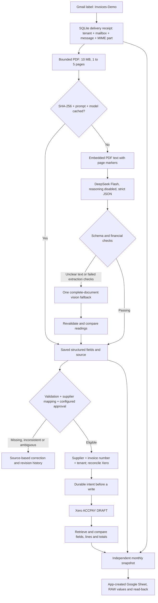

# Architecture

The API and workflow run in one Python FastAPI worker. SQLite stores deliveries, invoice identities, attempts, revisions and policy. Complete PDF sources and extraction responses are local files. Fernet-encrypted Google and Xero token stores are separate.

Three identities serve different purposes:

| Identity | Purpose |
| --- | --- |
| Tenant + mailbox + Gmail message + MIME part | Skip a delivery already seen. Gmail download locators can rotate. |
| PDF SHA-256 + prompt hash + model | Reuse the same extraction and avoid another paid request. |
| Tenant + configured supplier + invoice number | Reconcile the same business invoice across different PDF exports. |

Before accounting writes, the application validates an active expense account and purchase-tax mapping against Xero. A stable creation intent is saved before POST. A lost response triggers reconciliation. An uncertain intent with no found bill stays held instead of blindly creating another bill. Other systems writing concurrently are outside the local lock's protection.

The model extracts printed facts. Deterministic code checks arithmetic and business rules. Text/vision disagreement remains held. Unknown suppliers require explicit mapping. Approval can be required, and changes invalidate the approval signature. Automatic is the default; invalid data remains held in either mode.

A poll reads at most ten messages and permits at most three uncached documents, each with at most one text and one vision request. API failures do not trigger paid fallback retries. Monthly reporting never invokes model extraction or accounting creation. Report month follows invoice date, falling back to received month UTC for missing/invalid dates.
